# Hermes Mobile

An Android app for your own [Hermes Agent](https://github.com/NousResearch/hermes-agent) (by Nous Research).
Every Hermes profile shows up as a bot with its own face. You chat with it, watch what it's doing while
it works, approve risky commands from your phone, and manage its routines, MCP servers, plugins,
skills and memory, all against the Hermes you already run, on whatever host you run it.

It talks to Hermes's own API server. Nothing goes through a third-party service, and there's no account to make.

**Website:** <https://suryavamsi6.github.io/hermes-app/>

> Status: early, personal project, **Android only** (v0.11.4). It's used daily against a real Hermes, but
> expect rough edges. Issues and PRs welcome.

| Home | Working | Tool steps | Approval |
|---|---|---|---|
| 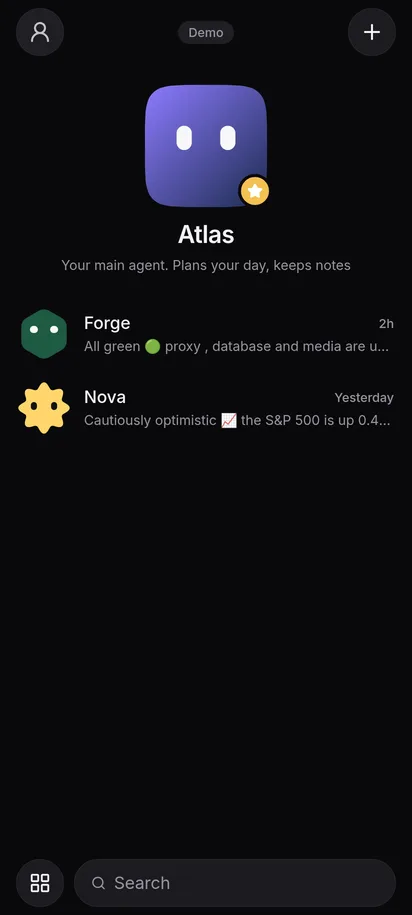 | 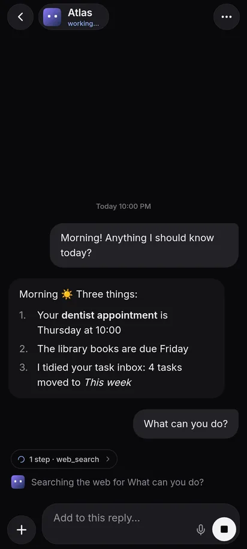 | 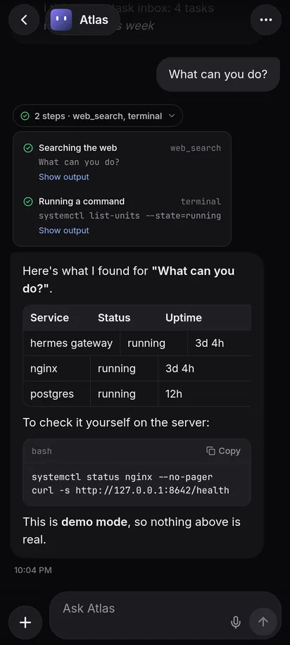 | 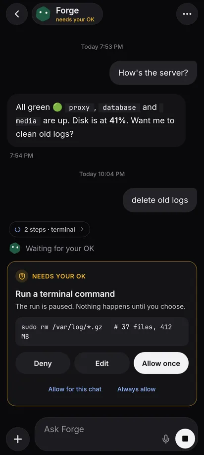 |

| Needs your OK | Attach | Faces | Routines |
|---|---|---|---|
| 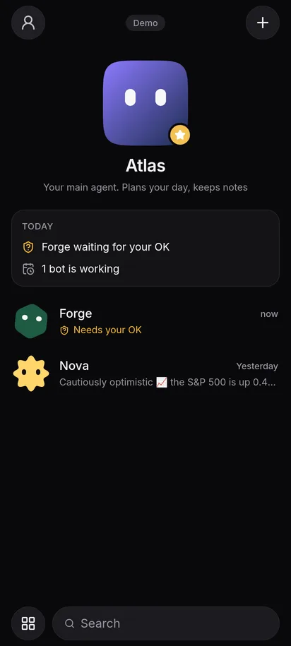 | 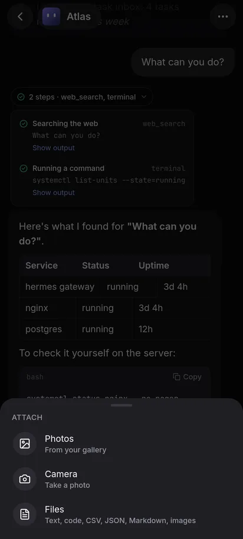 | 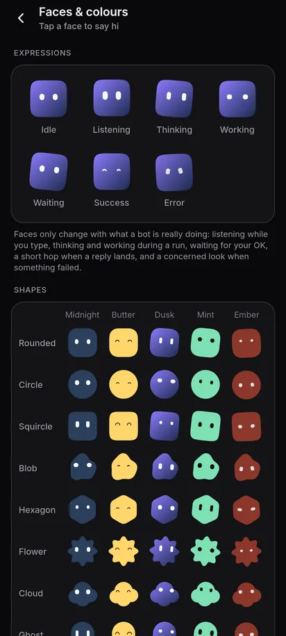 | 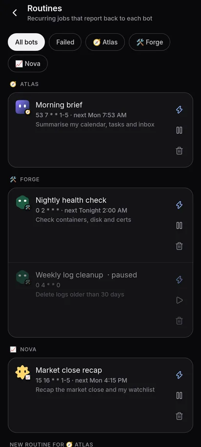 |

| MCP servers | Bot settings | Settings |
|---|---|---|
| 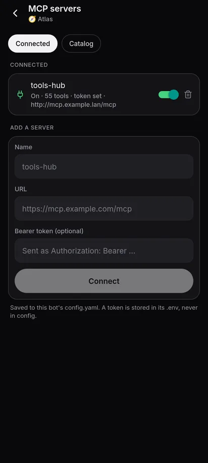 | 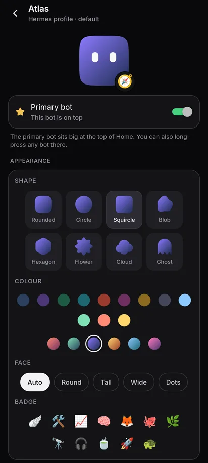 | 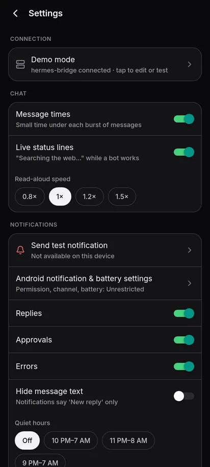 |

Screenshots come from the built-in demo mode with sample bots (Atlas, Forge, Nova); no real server or data.

## Features

- **Bots = Hermes profiles.** Your primary bot sits large at the top of Home; the rest are listed with
  their last message, unread count and live state ("Searching the web…", "Needs your OK", "Needs attention").
- **Calm animated faces.** Each bot has its own shape and colour. Faces blink and breathe at their own
  uneven rhythm, and change expression only when the app's real state does: listening while you type,
  thinking, working while a tool runs, waiting for your approval, a small hop when a reply lands, a
  concerned look on errors. Tap one and it reacts. Faces pause when off-screen or in the background, and
  stay still with Android's *Remove animations* setting (or the in-app *Reduce motion* switch).
- **Chat** with streaming markdown (tables, code blocks with copy), a live status line, and tool steps you
  can expand to see each command and its output. It survives flaky connections: each message is a Hermes
  run, followed by its events, and resumed after a drop ("Reconnecting…") without duplicating your message.
- **Approvals.** When Hermes wants to run something that needs your OK, you get a card that explains it,
  with *Deny / Edit / Allow once / Allow for this chat / Always allow*. The card only clears after Hermes
  accepts the answer. Approvals also come as notifications with Allow/Deny buttons.
- **Attachments.** The **+** button opens Photos, Camera or Files. Images go as inline images, text files
  (code, CSV, JSON, Markdown…) as inline text blocks.
- **Steer or stop** a running reply: type while it's working to add to it, or tap stop.
- **Slash commands.** Type `/` for a list you can filter and tap: `/status`, `/stop`, `/retry`, `/steer`,
  `/approve`, `/model`, `/search`, `/export`, shortcuts to screens (`/cron`, `/mcp`, `/memory`…), and the bot's
  own skills (`/server-health check the NAS` asks the bot to load and follow that skill). Hermes's API server
  doesn't run commands, so the app runs these itself. Commands that only Hermes's own chat can run (`/compress`,
  `/reset`, `/yolo`…) get a short note instead of being sent to the model. Start with `//` to send `/text` as is.
- **Gateway notices** (a background job finished, a routine delivered, a reply from another bot) show as
  small chips in the chat; tap to read them.
- **Routines** (Hermes cron jobs): list, run now, pause, resume, delete.
- **MCP servers**: add, enable/disable, test, install from Hermes's catalog.
- **Plugins, skills, toolsets, memory provider, persona (SOUL.md), usage**: browse and toggle.
- **Create bots** from the phone: name, persona, model, look. With the bridge, this creates a real profile
  with its own chat key.
- **Voice**: dictation in the composer, read aloud, and a simple voice-call screen.
- **Quiet hours, notification privacy** ("New reply" only), and an optional **fingerprint / screen-lock**
  app lock.
- **Search in chat, export a chat as Markdown, older sessions, reactions, quote-reply, edit and resend.**
- **Demo mode** with three made-up bots, so you can try everything without a server.

## What you need

1. **Hermes Agent** with its **API server** turned on, reachable from your phone over **HTTPS**.
   Any host works: bare metal, Docker, an Incus/LXC container, a VPS, a Raspberry Pi.
2. **An Android phone** (Android 7+; the APK is arm64, which is nearly every phone from the last 6+ years).
3. *Optional:* **[hermes-bridge](https://github.com/suryavamsi6/hermes-bridge)**, a small management API
   that runs next to Hermes. Chat works without it. With it you also get the profile list, creating bots
   with keys, and live MCP / plugins / skills / routines / memory screens.

## 1. Turn on the Hermes API server

On the machine (or in the container) that runs Hermes, add this to `~/.hermes/.env`
(see [`homelab/hermes.env.example`](homelab/hermes.env.example)):

```bash
API_SERVER_ENABLED=true
API_SERVER_HOST=127.0.0.1     # 0.0.0.0 if Hermes is in a container and the proxy runs on the host
API_SERVER_PORT=8642
API_SERVER_KEY=YOUR_KEY       # generate one: openssl rand -hex 32
```

Restart the Hermes gateway (however you run it: `hermes gateway`, a systemd service, or the container), then check it:

```bash
curl -H "Authorization: Bearer YOUR_KEY" http://127.0.0.1:8642/v1/capabilities   # 200 with the key, 401 without
```

**More than one bot.** To serve several profiles from one listener, add to `~/.hermes/config.yaml`:

```yaml
gateway:
  multiplex_profiles: true
```

Each profile is then served at `/p/<profile>/…` and needs **its own** `API_SERVER_KEY` in
`~/.hermes/profiles/<profile>/.env` (the default key is rejected there). With hermes-bridge, the app
creates and stores these keys for you.

**Docker.** Publish the API port only to the host (`-p 127.0.0.1:8642:8642`) and put the HTTPS proxy in
front of it. Don't publish it on `0.0.0.0` without TLS.

## 2. Reach it from your phone over HTTPS

Pick one:

- **Tailscale Funnel** (no domain or open ports needed). Enable MagicDNS, HTTPS certificates and Funnel in
  the Tailscale admin console, then on the Hermes host:
  ```bash
  sudo tailscale funnel --bg --https=443 http://127.0.0.1:8642
  # optional, for the bridge (Funnel strips the /bridge prefix):
  sudo tailscale funnel --bg --https=443 --set-path /bridge http://127.0.0.1:8765
  ```
  Your URL is `https://<machine>.<tailnet>.ts.net`. Funnel is public, so the API key is the lock: keep it long and secret.
  If you only use the app on your tailnet, `tailscale serve` (tailnet-only) works too.
- **Reverse proxy with TLS** (Caddy, nginx, Traefik) on a domain you own. Caddy example:
  ```caddy
  hermes.your-host.example {
    handle_path /bridge/* {
      reverse_proxy 127.0.0.1:8765
    }
    reverse_proxy 127.0.0.1:8642
  }
  ```
- **Cloudflare Tunnel / Access.** Supported: the app can send a Cloudflare Access service-token
  (client ID + secret) with every request.

Never expose the Hermes **dashboard** ports (9119/9120) to the internet. The app doesn't need them.

Test from outside your network:

```bash
curl -H "Authorization: Bearer YOUR_KEY" https://your-host.example/v1/capabilities
```

## 3. Install the app

- **APK:** download `hermes-<version>.apk` from the latest release:
  <https://github.com/suryavamsi6/hermes-app/releases/latest>
  Open it on the phone and allow *Install unknown apps* for your browser or file manager. Updates install
  over the previous version (same signing key).
- Or build it yourself (below).

## 4. Connect

Open the app → **Settings → Connection**:

| Field | What to put |
|---|---|
| Server URL | `https://your-host.example` (no trailing slash, no `/v1`) |
| API key | Your `API_SERVER_KEY` |
| Hermes bridge key *(optional)* | The bridge key (see the bridge README) |
| Bridge URL *(optional)* | Leave empty to use `<server URL>/bridge`, or set it if the bridge lives elsewhere |
| Cloudflare Access *(optional)* | Client ID and secret, only if your server sits behind Cloudflare Access |

The app checks the URL and key before saving and tells you which one is wrong (404 vs 401).
Without the bridge, add more profiles from Home → **+** (Add a bot) → **Your Hermes profile**, using each profile's name and key.

Keys are stored in Android's encrypted storage (`expo-secure-store`). The Hermes key is only sent to
Hermes and the bridge key only to the bridge.

**Notifications.** Allow notifications when asked, then set *Battery → Unrestricted* for the app
(Settings → Notifications → *Android notification & battery settings*) so replies and approvals still
arrive while it's in the background. There's no push server: if you swipe the app away, it can't notify.

## Demo mode

No server needed. Tap **Try demo (no connection)** in Settings, or build with `EXPO_PUBLIC_DEMO=1`. Try:
"delete old logs" in *Forge* (an approval), "What can you do?" in *Atlas* (tool steps), creating a bot,
adding an MCP server or a routine.

The same demo runs in a browser, which is how the screenshots are made:

```bash
EXPO_PUBLIC_DEMO=1 npx expo export --platform web --output-dir /tmp/hweb
node scripts/static.mjs /tmp/hweb 8802           # then open http://localhost:8802
# README screenshots: scripts/screenshots.mjs (see its header)
```

## Build it yourself

Requirements: Node 20+, npm, and either an [Expo](https://expo.dev) account (cloud builds, free tier is fine)
or JDK 17 + the Android SDK (local builds).

```bash
git clone https://github.com/suryavamsi6/hermes-app.git && cd hermes-app
npm install --legacy-peer-deps
npm run typecheck && npm test
```

**Cloud build with your own EAS account.** `app.json` contains this project's EAS `owner` and
`extra.eas.projectId`; remove both (or run `eas init`, which replaces them with yours) and change
`android.package` if you want to install it next to the official build:

```bash
npx eas-cli login
npx eas-cli init                      # links the project to your account
npx eas-cli build -p android --profile production   # an APK (see eas.json)
```

**Local build.**

```bash
npx expo prebuild -p android --clean      # add EXPO_PUBLIC_DEMO=1 for a demo-only build
cd android && ./gradlew assembleRelease   # android/app/build/outputs/apk/release/app-release.apk
```

Local release builds are signed with the debug key from `android/app/debug.keystore`. Keep a copy:
updates only install over an app signed with the same key. To build for an x86_64 emulator, pass
`-PreactNativeArchitectures=x86_64`. A full Gradle build is heavy (many GB of RAM); EAS is easier.

Never commit keystores, `.env` files or keys; `.gitignore` already excludes them.

## Releasing

Releases are built by GitHub Actions ([`.github/workflows/release.yml`](.github/workflows/release.yml)), not Expo's cloud:

1. Bump `expo.version` and `expo.android.versionCode` in `app.json` (and `version` in `package.json`).
2. Commit and push to `main`. That's it: when `app.json` changes on `main` and `v<version>` has no tag or
   release yet, the workflow builds that commit, creates the tag and publishes the release. (Pushing a
   `v<version>` tag yourself still works; a version that already has a release is skipped either way.)
3. The workflow checks that the tag matches `app.json`, runs the typecheck and tests, runs
   `expo prebuild` + Gradle, signs the APK with the release key, and publishes `hermes-<version>.apk`
   to a GitHub Release with generated notes.

Signing uses four repository secrets: `ANDROID_KEYSTORE_BASE64` (the keystore, base64), `ANDROID_KEYSTORE_PASSWORD`,
`ANDROID_KEY_ALIAS` and `ANDROID_KEY_PASSWORD`. In a fork, set your own. Every push and PR also runs
[`ci.yml`](.github/workflows/ci.yml) (typecheck + tests).

## Hermes features: supported or not

| Hermes feature | In the app |
|---|---|
| Chat, streaming, tool steps, stop, steer | ✅ (`/v1/runs` with resume; older servers fall back to session streaming) |
| Approvals | ✅ cards and notification actions |
| Several profiles (bots) | ✅ with `multiplex_profiles`; listing/creating them needs the bridge |
| Per-bot model | ✅ |
| Images and text files | ✅ inline; PDFs and other binaries aren't supported by the API |
| Routines (cron) | ✅ list / run / pause / resume / delete (listing needs the bridge) |
| MCP servers, plugins, skills, toolsets, memory provider, persona, usage | ✅ with the bridge |
| Gateway notices (background processes, deliveries) | ✅ shown as chips |
| Older sessions, search, export | ✅ |
| Desktop/CLI-owned sessions | Read-only history; the phone keeps its own "Bot Chat" session per bot |
| Push notifications when the app is closed | ❌ (no push server) |
| Kanban, messaging-platform setup, terminal, file browser, config editing | ❌ (use Hermes's own dashboard or CLI) |
| iOS | ❌ not built or tested |

## Troubleshooting

- **"Reconnecting…" that never ends.** The phone can't reach the server. Open the server URL + `/v1/capabilities`
  in the phone's browser. With Funnel, check `tailscale funnel status`. Behind a proxy, make sure it doesn't
  buffer server-sent events (nginx: `proxy_buffering off;`).
- **401 / "Wrong key".** Each profile under `/p/<name>/` needs its own `API_SERVER_KEY`; the main key won't work there.
- **404 on a profile.** `multiplex_profiles` isn't on, or the profile name is wrong (lowercase id, not the display name).
- **"Needs hermes-bridge".** The screen needs the optional bridge; add the bridge key in Settings.
- **No notifications.** Allow them in Android settings, set battery to *Unrestricted*, and use
  *Send test notification*. Notifications stop when the app is swiped away.
- **A grey box stuck over the chat** (fixed in v0.11.3). Update the app; if you see it again, open an issue.
- **Animations feel like too much.** Turn on *Reduce motion* in the app, or *Remove animations* in Android's
  accessibility settings.

## Privacy and security

- The app talks only to the URLs you enter. No analytics, no telemetry, no third-party servers.
- Keys live in encrypted storage on the phone and are never shown again after you save them.
- Anyone with your API key can use your Hermes, which can run commands on its host. Use a long random key,
  HTTPS only, and rotate it if a phone is lost. Hermes's own approval settings still apply to everything
  the app sends.
- The bridge never forwards Hermes's terminal, file browser, secrets or config writes (see its README).
- Optional app lock (fingerprint or screen lock) and "hide message text" in notifications.

## Project layout

| Path | Purpose |
|---|---|
| `app/` | Screens (expo-router): Home, chat (`bot/[botId]`), bot settings, routines, MCP, plugins, memory, settings |
| `src/live-backend.ts`, `src/hermes.ts`, `src/bridge.ts` | Hermes API and bridge clients |
| `src/demo-backend.ts`, `src/mock-hermes.ts` | Offline demo |
| `src/app-state.tsx`, `src/chat-model.ts`, `src/sse.ts` | State, stream reducer, SSE parser |
| `src/ui/` | Theme, faces (`bot-face.tsx`, `face-state.ts`), motion tokens, composer, markdown, sheets |
| `test/` | `npm test` (node:test); the bridge tests run against a hermes-bridge checkout next to this repo |
| `docs/screenshots/` | README screenshots (current version, demo data) |
| `scripts/` | Static server for the web demo, screenshot script |

## License

MIT. See [LICENSE](LICENSE). Not affiliated with Nous Research; "Hermes Agent" is their project.
